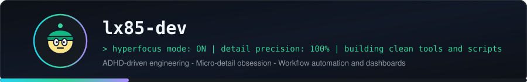

---

## About Me

I build software, automation scripts, and clean custom interfaces when **ADHD hyperfocus** locks onto a problem and refuses to let go until every edge case makes sense.

* **Hyperfocus & Precision:** When an idea clicks, I can dive deep for hours—refining layouts, fixing subtle bugs, and tuning workflows until the structure feels sharp and consistent.
* **Eye for Micro-Details:** Small inconsistencies stand out immediately to me. Spacing, naming conventions, predictable behavior, and clean state handling matter just as much as raw functionality.
* **Practical Automation:** I like turning repetitive tasks and messy manual steps into fast, reliable tools, dashboards, and scripts that save time in everyday life.
* **Constant Iteration:** I rarely stop at "kind of works"—I test, tweak, rebuild, and polish until the result feels cohesive and genuinely usable.

---

## How I Work

| Trait | What It Looks Like in Practice |
| :--- | :--- |
| **Hyperfocus** | Deep, uninterrupted build sessions where whole features or tools come together fast. |
| **Detail Obsession** | Catching minor visual, structural, or logic flaws that others easily skim past. |
| **System Thinking** | Breaking workflows into clear steps, clean rules, and repeatable setups. |
| **Hands-On Polish** | Iterating quickly on UI, scripts, and edge cases until everything aligns. |

---

## Current Focus

* **Workflow & Utility Tools:** Building fast web apps, helpers, and scripts tailored to real daily needs.
* **Clean Architecture & UI:** Keeping interfaces uncluttered, responsive, and easy to navigate under pressure.
* **Automation & Scripting:** Reducing friction with smart defaults, clear structure, and reliable execution.
